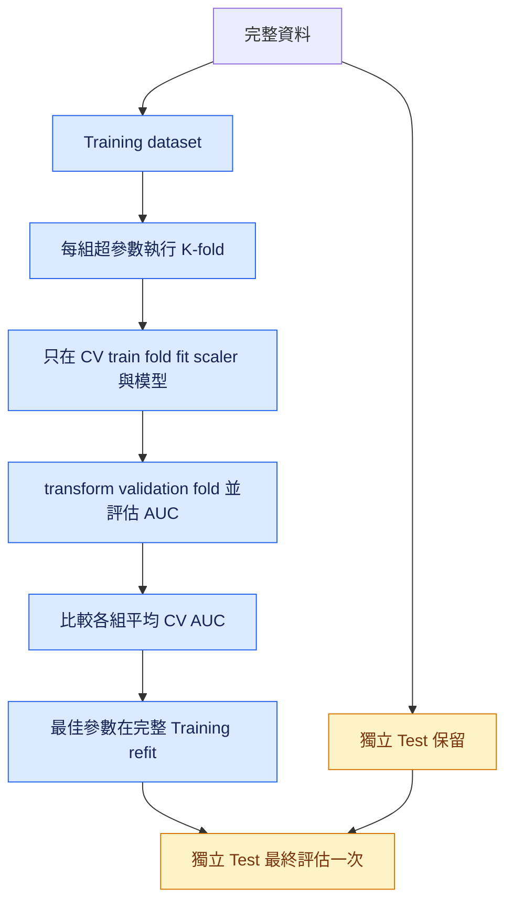

# 03 — Model Development & Evaluation


[返回目錄](README.md)

> **學習目標**：能在沒有提示下完成 split → train → validation selection → threshold tuning → final test，且不洩漏資料。

> 閱讀導向：先掌握核心觀念、語法與完整範例；Concept checks 可直接展開答案，非必須獨立考試。P0 為核心，P1 為延伸。

## 1. Dataset splitting 

| Dataset | 用途 | 是否 fit |
|---|---|---|
| Training | 學習模型與 preprocessing 參數 | 是 |
| Validation | 模型、超參數、threshold 選擇 | 否（評估當下） |
| Test | 最終泛化評估 | 否 |

```python
from sklearn.model_selection import train_test_split
X_dev, X_test, y_dev, y_test = train_test_split(
    X, y, test_size=.2, stratify=y, random_state=42)
X_train, X_valid, y_train, y_valid = train_test_split(
    X_dev, y_dev, test_size=.25, stratify=y_dev, random_state=42)
```

比例為 60/20/20。`stratify` 保留近似 class ratio；不能保證 merchant ID 隔離。若同一商家多筆資料，使用 GroupKFold/GroupShuffleSplit（或視需求 StratifiedGroupKFold）；若預測未來，按時間切分，必要時加 gap。切分方法取決於部署目標：預測既有商家未來訂單與預測新商家是不同任務。

## 2. Model development 

```python
from sklearn.linear_model import LogisticRegression
from sklearn.ensemble import RandomForestClassifier
from sklearn.metrics import roc_auc_score
models = {
    'logistic': LogisticRegression(C=1, max_iter=1000, random_state=42),
    'random_forest': RandomForestClassifier(n_estimators=100, max_depth=3, random_state=42)
}
scores = {}
for name, model in models.items():
    model.fit(X_train, y_train)
    scores[name] = roc_auc_score(y_valid, model.predict_proba(X_valid)[:, 1])
best_name = max(scores, key=scores.get)
best_model = models[best_name]
test_auc = roc_auc_score(y_test, best_model.predict_proba(X_test)[:, 1])
```

範例假設 features 已正確預處理、binary labels 為 0/1，且 `classes_[1]` 是正類。`predict()` 回傳預測類別；`predict_proba()` 回傳各類別機率（順序依 `classes_`）；`decision_function()` 可提供排序分數供 AUC 使用。`max(scores, key=scores.get)` 回傳 key；`max(scores.items(), key=lambda x:x[1])` 回傳 (key,value)。若同分，Python max 取第一個遇到的項目。

> ⚠️ 已訓練的模型不可再用 validation fit 後拿 test 選模型。資料不應在選擇流程中流入 test。

## 3. Comprehensive review — estimator selection and regression workflow (P0) 

| Estimator | Important controls | When to consider |
|---|---|---|
| LinearRegression | fit_intercept | interpretable linear baseline |
| Ridge | alpha (larger = more L2 shrinkage) | correlated predictors |
| Lasso | alpha, max_iter | sparse coefficients |
| ElasticNet | alpha, l1_ratio | correlated features + sparsity |
| LogisticRegression | C (smaller = stronger regularization), max_iter, class_weight | classification baseline |
| KNeighborsClassifier / Regressor | n_neighbors, weights, metric | local patterns, scaled features |
| SVC / SVR | C, kernel, gamma; SVR epsilon | nonlinear boundaries, moderate data |
| DecisionTree | max_depth, min_samples_leaf, criterion | interpretable nonlinear splits |
| RandomForest | n_estimators, max_features, max_depth, min_samples_leaf | robust nonlinear tabular baseline |
| GradientBoosting | n_estimators, learning_rate, max_depth, subsample | sequential improvement |
| HistGradientBoosting | max_iter, learning_rate, max_leaf_nodes, l2_regularization | larger numeric tabular datasets |
| GaussianNB | var_smoothing | simple Gaussian class-conditional baseline |
| DummyRegressor | strategy=median or mean | sanity baseline |

Most estimators implement fit/predict; classifiers may expose predict_proba or decision_function. Trees accept nonlinear interactions without scaling; distance and regularized linear methods benefit from appropriate scaling. No model is universally best. For external boosting libraries (XGBoost, LightGBM, CatBoost), verify availability and version; sklearn alternatives are enough for the core workflow.

### End-to-end regression: train / validation / unlabeled test

Assume train.csv and val.csv contain numeric features and target 'price', test.csv contains the same features but no target; all have a unique 'id'. Adapt the schema to the actual task.

```python
import pandas as pd
from sklearn.base import clone
from sklearn.pipeline import make_pipeline
from sklearn.impute import SimpleImputer
from sklearn.preprocessing import StandardScaler
from sklearn.dummy import DummyRegressor
from sklearn.linear_model import Ridge
from sklearn.ensemble import RandomForestRegressor, GradientBoostingRegressor
from sklearn.metrics import mean_absolute_error

train, val, test = [pd.read_csv(f'{p}.csv') for p in ['train','val','test']]
features = train.columns.drop(['id','price'])
X, y = train[features], train.price
Xv, yv = val[features], val.price
Xt = test[features]
models = {
    'baseline': DummyRegressor(strategy='median'),
    'ridge': make_pipeline(SimpleImputer(strategy='median'),StandardScaler(),Ridge(alpha=1)),
    'rf': make_pipeline(SimpleImputer(strategy='median'),RandomForestRegressor(
        n_estimators=150,min_samples_leaf=3,random_state=42,n_jobs=-1)),
    'gb': make_pipeline(SimpleImputer(strategy='median'),GradientBoostingRegressor(
        loss='absolute_error',n_estimators=150,learning_rate=.05,max_depth=3,random_state=42))
}
scores = {}
for name,m in models.items():
    m.fit(X,y)
    scores[name] = mean_absolute_error(yv,m.predict(Xv))
best = min(scores,key=scores.get)
# Only after selection is final; val is no longer an independent evaluation.
final = clone(models[best]).fit(pd.concat([X,Xv]),pd.concat([y,yv]))
submission = pd.DataFrame({'id':test.id,'price':final.predict(Xt)})
assert len(submission)==len(test)
submission.to_csv('submission.csv',index=False)
```

For mixed types, replace the numerical preprocessing with Chapter 02 ColumnTransformer. The median minimizes expected absolute error; mean minimizes expected squared error. In sklearn CV, use scoring='neg_mean_absolute_error' (larger is better, reverse sign to report MAE). Do not calculate test MAE without labels. If submission schema requires a different column or row order, follow it exactly.

### Tuning, diagnosis and interpretation
Start with baseline and 2–3 credible models, compare on the same validation split. Grid search enumerates candidates; randomized search samples candidates and is useful for wider spaces. Tune learning_rate jointly with iterations; early stopping uses held-out data, never final test. For residuals e=y-pred, positive means underprediction. Inspect mean signed error, MAE by segment, residual vs prediction and extreme errors; improving global MAE can hurt a minority segment. Learning curves compare train and validation performance as sample size increases; validation curves vary hyperparameters.

Permutation importance measures validation-score degradation after shuffling a feature; correlated features may mask each other. Tree impurity importance can favor high-cardinality features. SHAP (P1) explains model predictions relative to a baseline, not causal effects. For skewed nonnegative targets, log1p/expm1 can help but select by original-scale metric; inverse transformation does not automatically yield unbiased conditional means.

Reference: [scikit-learn supervised learning](https://scikit-learn.org/stable/supervised_learning.html).

## 4. Confusion Matrix（固定方向） 

| Actual ↓ / Predicted → | Positive | Negative |
|---|---:|---:|
| Actual Positive | TP | FN |
| Actual Negative | FP | TN |

| Metric | Formula | Meaning |
|---|---|---|
| Accuracy | (TP+TN)/(TP+TN+FP+FN) | 全體正確率 |
| Precision | TP/(TP+FP) | 預測正類中有多少為真 |
| Recall / TPR | TP/(TP+FN) | 真正正類中找出多少 |
| Specificity / TNR | TN/(TN+FP) | 真負類中排除多少 |
| FPR | FP/(FP+TN) | 真負類被誤報的比例 |
| F1 | 2PR/(P+R) | Precision/Recall 調和平均 |

例如 TP=80, FN=20, FP=40, TN=860：Accuracy=.94, Precision=.667, Recall=.8, FPR=.0444, F1=.7273。Fraud detection 通常需要關注 recall 與 review capacity；廣告高潛商家推薦可優先 precision 或 precision@K；不能僅因資料不平衡就認定某個 metric 永遠最佳。

```python
from sklearn.metrics import confusion_matrix, precision_score, recall_score, f1_score
# sklearn 原始矩陣為 labels=[0,1]：[[TN,FP],[FN,TP]]
tn, fp, fn, tp = confusion_matrix(y_test, y_pred, labels=[0,1]).ravel()
# 若要符合本教材表格，直接使用 labels=[1,0]：[[TP,FN],[FP,TN]]
```

## 5. ROC-AUC vs PR-AUC vs F1 

| Metric | Input | 意義 | 使用情境 |
|---|---|---|---|
| ROC-AUC | probabilities / scores | 隨機正類排名高於隨機負類的機率（ties 半分） | 整體排序能力 |
| Average Precision (AP) | probabilities / scores | 以 recall 增量加權的 precision | 正類稀少，重視正類排序 |
| F1 | binary labels | 特定 threshold 的 P/R 平衡 | 有明確決策 threshold |
| Precision@K | top K | 前 K 個候選中的正類比例 | 名單或人力上限 |

ROC 橫軸 FPR、縱軸 TPR；隨機模型 AUC 約 .5。PR 橫軸 recall、縱軸 precision；隨機排序 baseline 約正類比例。AP 不完全等於梯形積分 PR-AUC。ROC-AUC 高不代表營運 threshold 下 precision 足夠，也不代表 probability calibration 好。

```python
from sklearn.metrics import roc_auc_score, average_precision_score
auc = roc_auc_score(y_valid, valid_prob)
ap = average_precision_score(y_valid, valid_prob)
```

降低 threshold：TP 與 FP 不減、FN 與 TN 不增，因此 recall 不減、FPR 不減；precision 可能增加、下降或不變，並非數學上必然下降。

## 6. Regression metrics 

| Metric | Formula / meaning | 注意事項 |
|---|---|---|
| MAE | mean(abs(y-pred)) | 原單位，較不受大誤差支配 |
| MSE | mean((y-pred)^2) | 大誤差懲罰較大 |
| RMSE | sqrt(MSE) | 原單位，受極端誤差影響 |
| R² | 1-SSE/SST | 可為負，常數 target 需特別處理 |
| MAPE | mean(abs((y-pred)/y)) | y=0 或接近 0 時不適合 |

```python
from sklearn.metrics import mean_absolute_error, mean_squared_error, r2_score
mae = mean_absolute_error(y_test, pred)
rmse = mean_squared_error(y_test, pred)**0.5
r2 = r2_score(y_test, pred)
```

## 7. Log Loss / Binary Cross-Entropy 

Log Loss 評估機率預測的品質，越低越好；對自信但錯誤的預測懲罰特別大。

$$L=-\frac{1}{n}\sum_{i=1}^n[y_i\ln(p_i)+(1-y_i)\ln(1-p_i)]$$

| True label | Predicted positive probability | Loss |
|---|---:|---:|
| 1 | 0.9 | 0.1054 |
| 1 | 0.5 | 0.6931 |
| 1 | 0.1 | 2.3026 |
| 0 | 0.9 | 2.3026 |

```python
from sklearn.metrics import log_loss, roc_auc_score
import numpy as np
y = np.array([0, 0, 1, 1])
a = np.array([.1, .2, .8, .9])
b = np.array([.41, .42, .58, .59])
for p in [a,b]:
    print(roc_auc_score(y,p), log_loss(y,p))
```

兩組 AUC 都是 1，Log Loss 約為 0.1643 和 0.5362。AUC 評估排序，不保證機率校準好；Log Loss 評估給真實類別的機率。Accuracy 則依賴分類閾值。`scoring='neg_log_loss'` 在 sklearn 搜尋中取較大值，實際 loss 為其負值。手動計算可用 `np.clip(p, 1e-15, 1-1e-15)` 防止 log(0)。

> [!WARNING]
> 不要將 threshold 後的 0/1 label 當成機率傳入 Log Loss。AUC 也應使用連續分數。

**Practice:** Two classifiers have identical ROC-AUC but different log loss. Must their calibration be identical?

<details><summary>Answer</summary>

No. A strictly increasing transformation preserves ranking and therefore AUC, but changes the probabilities and generally changes log loss. Log loss alone does not isolate calibration from discrimination.

</details>

## 8. K-Fold + StandardScaler + GridSearchCV（重要筆記） 



```python
from sklearn.pipeline import Pipeline
from sklearn.preprocessing import StandardScaler
from sklearn.model_selection import GridSearchCV, StratifiedKFold
from sklearn.linear_model import LogisticRegression
from sklearn.metrics import roc_auc_score
pipeline = Pipeline([
    ('scaler', StandardScaler()),
    ('model', LogisticRegression(max_iter=1000, random_state=42))
])
cv = StratifiedKFold(n_splits=5, shuffle=True, random_state=42)
grid = GridSearchCV(pipeline, {'model__C':[.01,.1,1,10]},
                    scoring='roc_auc', cv=cv, refit=True)
grid.fit(X_train, y_train)
best_model = grid.best_estimator_
best_params = grid.best_params_
best_cv_auc = grid.best_score_
test_auc = roc_auc_score(y_test, best_model.predict_proba(X_test)[:,1])
```

若混合數值與類別特徵，將 StandardScaler 步驟換成 Chapter 02 的 ColumnTransformer。`model__C` 中 `model` 必須等於 Pipeline step 名稱。`refit=True` 會以最佳參數重新 fit 全部傳入 grid.fit 的資料；`grid.predict_proba()` 此時等同最佳 pipeline 的 predict_proba。5-fold × 4 組參數 = 20 次 CV fits，另有 1 次 refit。best_score_ 是最佳 CV 分數，不是無偏的 final test score。

## 9. Threshold optimization 

Business requirement: Maximize recall subject to precision >= 0.60. If tied, choose the highest threshold.

```python
from sklearn.metrics import precision_score, recall_score, f1_score, roc_auc_score
valid_prob = best_model.predict_proba(X_valid)[:,1]
best_threshold = None
best_recall = -1
for threshold in [0.3, 0.4, 0.5, 0.6, 0.7]:
    pred = (valid_prob >= threshold).astype(int)
    precision = precision_score(y_valid, pred, zero_division=0)
    recall = recall_score(y_valid, pred, zero_division=0)
    if precision >= .60 and recall >= best_recall:
        best_recall = recall
        best_threshold = threshold
if best_threshold is None:
    raise ValueError('No feasible threshold')
test_prob = best_model.predict_proba(X_test)[:,1]
test_pred = (test_prob >= best_threshold).astype(int)
test_metrics = {
    'precision': precision_score(y_test,test_pred,zero_division=0),
    'recall': recall_score(y_test,test_pred,zero_division=0),
    'f1': f1_score(y_test,test_pred,zero_division=0),
    'roc_auc': roc_auc_score(y_test,test_prob)
}
```

`>= best_recall` 可簡化 tie-breaking，因 thresholds 已由小到大排列。若順序不固定，使用 tuple 比較 `(recall, threshold)`。不能對 `y_valid` 真實 labels 做 threshold；也不能在 test 選 threshold。模型若重新 fit，機率尺度可能改變，原 threshold 不必然仍有效；本例直接評估已選定的模型。

## 10. Exam checklist 

- [ ] 分清 name（str）、model（estimator）、scores（dict）。
- [ ] `predict_proba` 拼字、`[:,1]`、正類確認。
- [ ] AUC 用 score；precision/recall/F1 用 label。
- [ ] GridSearchCV 的三個 best_ 屬性。
- [ ] threshold constraint、tie-break、無可行解。
- [ ] Test 不參與任何選擇。

## 11. Worked example & practice 

```python
import numpy as np
y_true = np.array([1,1,0,1,0,1,0,0,1,0])
y_prob = np.array([.90,.75,.65,.55,.45,.40,.35,.20,.15,.10])
```

Calculate ROC-AUC, AP, precision, recall and F1 at thresholds .5 and .3.

<details><summary>Reference solution and expected output</summary>

```python
for t in [.5,.3]:
    p = (y_prob>=t).astype(int)
    print(t, precision_score(y_true,p), recall_score(y_true,p), f1_score(y_true,p))
print(roc_auc_score(y_true,y_prob),average_precision_score(y_true,y_prob))
```

| Threshold | Precision | Recall | F1 |
|---|---:|---:|---:|
| .5 | .75 | .60 | .6667 |
| .3 | .5714 | .80 | .6667 |

ROC-AUC=.72；AP=.7944。
</details>

## 12. Additional model evaluation and implementation (P0)

| Task | sklearn implementation | Key input |
|---|---|---|
| Multiclass classification | classification_report(y_true,y_pred) | labels |
| Probability quality | log_loss(y_true,probs), brier_score_loss(y_true,p) | probabilities |
| Clustering | silhouette_score(X,labels), davies_bouldin_score(X,labels) | features + cluster assignments |
| Ranking | precision/recall at K | sorted scores |
| Calibration | calibration_curve(y_true,p,n_bins=10) | binary probabilities |

Multiclass macro gives each class equal weight; weighted weights by support; micro pools TP/FP/FN. In single-label multiclass classification, micro F1 equals accuracy when all classes included. Brier score is mean squared probability error for binary outcomes; lower is better. A perfectly ranked model can be poorly calibrated.

```python
from sklearn.cluster import KMeans
from sklearn.preprocessing import StandardScaler
from sklearn.metrics import silhouette_score, davies_bouldin_score
# X_numeric: complete finite numeric matrix; > max(k) observations
Z=StandardScaler().fit_transform(X_numeric)
scores={}
for k in range(2,7):
    labels=KMeans(n_clusters=k,n_init=10,random_state=42).fit_predict(Z)
    if 2<=len(set(labels))<len(Z):
        scores[k]=silhouette_score(Z,labels)
best_k=max(scores,key=scores.get)
```

For clustering without labels, silhouette and Davies-Bouldin are internal criteria, not evidence of business usefulness. DB index lower is better. Evaluate stability, cluster size and interpretability; if true labels exist, adjusted Rand index can compare assignments. For prediction on new entities fit preprocessing and cluster model on development data; use KMeans.predict for new points.

### Randomized search and early stopping (P1)
RandomizedSearchCV samples parameter candidates, unlike exhaustive grid. Choose distributions/ranges appropriate to parameter scale; set random_state. For early stopping, monitor held-out loss and retain best iteration; never monitor test. For forecasting, chronological validation matters more than random split; compare naive last-value/seasonal baselines and prevent future exogenous-feature leakage.

<details><summary>Concept check: does the model with best ROC-AUC necessarily have lowest Log Loss?</summary>

No. ROC-AUC measures ordering, while Log Loss penalizes inaccurate or overconfident probabilities. The same ordering can have different probability calibration.

</details>

[下一章：ML Fundamentals →](04-ml.md)
