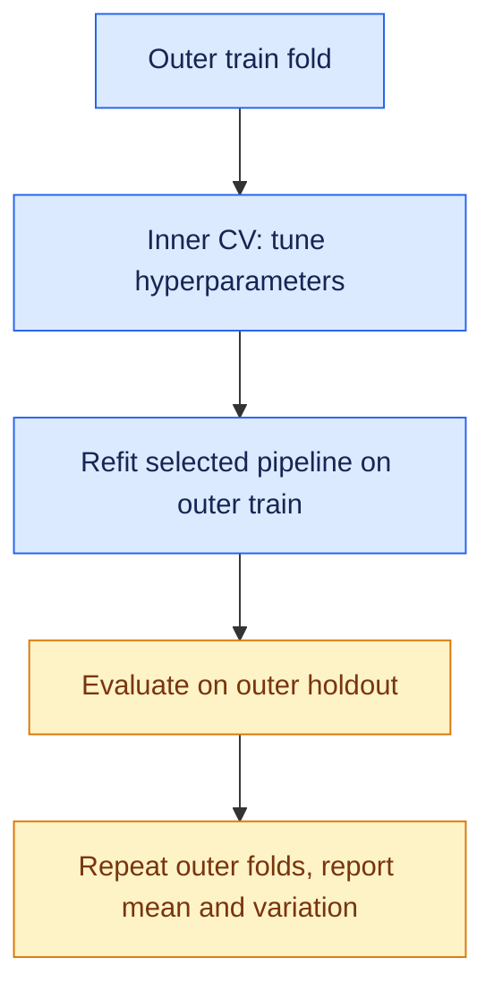

# 04 — Machine Learning Fundamentals


[返回目錄](README.md)

## 1. Learning paradigms

| Method | Label | Example |
|---|---|---|
| Supervised | 有 target | churn, fraud, GMV regression |
| Unsupervised | 無 target | merchant segmentation, anomaly exploration |
| Semi-supervised | 少量有標籤、大量無標籤 | 商品分類 |

Clustering 不會自動找出「高潛商家」；需以商業指標驗證 cluster profiling。若只有採用廣告的商家有 label，可能有 selection bias，模型未必能泛化到全部商家。

## 2. Linear Regression

模型：$\hat y=\beta_0+\sum_j\beta_jx_j$；OLS 最小化 SSE。係數代表其他特徵固定時，x 增加一單位的預測差異，並不必然代表因果。

- 線性指條件平均對參數線性，不要求所有原始 x 與 y 都呈直線（可做多項式特徵）。
- 誤差獨立、零條件均值等是推論假設；同方差影響傳統標準誤，常態誤差主要關係有限樣本推論。
- Multicollinearity 使係數不穩定；高 R² 不代表因果或泛化好。

```python
from sklearn.linear_model import LinearRegression, Ridge, Lasso
lr = LinearRegression().fit(X_train,y_train)
pred = lr.predict(X_test)
```

## 3. Logistic Regression

$z=\beta_0+\beta^Tx$；$p=1/(1+e^{-z})$；$\log(p/(1-p))=z$。

係數增加 1 單位的 odds ratio 為 $e^{\beta_j}$（其餘固定）。例如 β=.693，odds 約乘 2，不代表 probability 加倍。

Binary cross-entropy：$-\frac1n\sum_i[y_i\log p_i+(1-y_i)\log(1-p_i)]$。

| Regularization | Penalty | 效果 |
|---|---|---|
| L1 | λΣ abs(β) | 可產生零係數，稀疏選特徵 |
| L2 | λΣ β² | 平滑收縮，通常不歸零 |

sklearn LogisticRegression 的 `C` 為 regularization strength 的反向控制：C 小 → stronger regularization。Ridge/Lasso 的 alpha 則大 → stronger。不同模型 penalty 的精確 scaling 定義可能不同。

## 4. Decision Tree

Classification 使用 Gini $1-\sum p_k^2$ 或 entropy $-\sum p_k\log_2 p_k$ 衡量 impurity；尋找最大 weighted impurity reduction。Regression tree 常用 squared error。

例：節點 5 正 / 5 負，Gini=.5。切成兩節點各 5 筆，4P1N 與 1P4N，Gini 都 .32；gain=.18。

| Parameter | 增加的典型效果 |
|---|---|
| max_depth | 複雜度增加，可能過擬合 |
| min_samples_leaf | 限制小葉節點，通常降低 variance |
| min_samples_split | 限制分裂，通常降低複雜度 |

優點：非線性、交互作用、不需 scaling。缺點：單棵樹 high variance、外插差。Impurity importance 偏好高基數特徵，且相關特徵會分攤重要性。

## 5. Random Forest

Bootstrap 訓練多棵樹，每個 split 隨機挑 feature subset，分類聚合 probabilities 或 votes（sklearn predict 使用平均 probabilities）。Bagging 主要降低 variance，樹相關性越低越有利。

```python
from sklearn.ensemble import RandomForestClassifier
rf = RandomForestClassifier(n_estimators=100,max_depth=5,
                            min_samples_leaf=5,random_state=42)
```

增加 n_estimators 通常使結果更穩定但增加成本；深度與 leaf size 控制單棵樹複雜度。OOB 是未被該樹 bootstrap 抽中的樣本，可估計泛化，但若拿 OOB 選很多模型仍需獨立最終評估。

## 6. Gradient Boosting

循序建立 weak learners，下一棵樹修正目前 ensemble loss 的負梯度。Squared-error loss 下可理解為擬合 residual；其他 loss 則不只是 raw residual。

$F_m(x)=F_{m-1}(x)+\eta h_m(x)$。

| Bagging / RF | Boosting |
|---|---|
| 多棵樹相對獨立 | 依序修正前一輪誤差 |
| 主要降低 variance | 常用於降低 bias，也可能過擬合 |
| 可平行訓練 | 訓練依賴前一輪 |

learning_rate 小常需要更多 trees；max_depth、subsample、early stopping 皆能影響泛化。XGBoost/LightGBM/CatBoost 各有實作差異，不應假設任一永遠最好。

## 7. SVM

最大化 margin；soft margin 容許分類錯誤。C 大通常較少容忍錯分，可能提高 variance；C 小較強正則化。RBF kernel 的 gamma 大，單筆樣本影響範圍較小，決策邊界可能更複雜。

```python
from sklearn.svm import SVC
from sklearn.pipeline import make_pipeline
from sklearn.preprocessing import StandardScaler
svm = make_pipeline(StandardScaler(),SVC(C=1,kernel='rbf',gamma='scale'))
# AUC 可直接使用 decision_function；若需 predict_proba 須設 probability=True
```

SVM 對尺度敏感，大資料的 kernel SVM 成本可能高。Linear SVM 適合高維 sparse features。

## 8. K-Means & Clustering

目標：最小化 within-cluster SSE $\sum_i\|x_i-\mu_{c_i}\|^2$。初始化中心 → assign 最近中心 → 更新均值 → 重複直到收斂。對 scaling、初始化、outliers 敏感；偏好近似球形、大小相近的 cluster。

```python
from sklearn.cluster import KMeans
from sklearn.metrics import silhouette_score, davies_bouldin_score
from sklearn.preprocessing import StandardScaler
Z = StandardScaler().fit_transform(X)
for k in range(2,6):
    m = KMeans(n_clusters=k,n_init=10,random_state=42).fit(Z)
    print(k,m.inertia_,silhouette_score(Z,m.labels_),
          davies_bouldin_score(Z,m.labels_))
```

假設至少 6 筆有效樣本，且各 k 產生足夠不同 clusters。

| Metric | 越好方向 | 解讀 |
|---|---|---|
| Inertia | 越低（k 增大通常下降） | Elbow 看邊際改善，不是直接取最低 |
| Silhouette | 越高，範圍 [-1,1] | $(b-a)/\max(a,b)$；a 組內平均距離，b 最近其他組平均距離 |
| Davies-Bouldin | 越低 | 組內分散 / 組間距離 |

最佳 k 還需穩定性、解釋性、營運可執行性。PCA 可降維/去相關，但最大 variance 不保證對 target 最有用；supervised task 中 PCA 必須在 train fold fit。

## 9. Bias–variance & regularization

Squared loss 的期望預測誤差可分解為 bias² + variance + irreducible noise（固定 x、對訓練集與噪音取期望）。

| Pattern | Interpretation | Action |
|---|---|---|
| Train poor, validation poor | 可能 underfit/high bias | 更合適特徵、提高容量、減少正則化 |
| Train strong, validation poor | 可能 overfit/high variance | 更多資料、正則化、簡化模型 |
| Both strong | 泛化可能良好 | 仍需獨立 test 與 drift 檢查 |

資料分布改變也會造成 train/valid gap，不應直接斷定 overfitting。Learning curve 比較不同 training size 的 train/valid performance。

## 10. Validation, leakage & nested CV

| Risk | Example | Remedy |
|---|---|---|
| Temporal leakage | 用下月 GMV 預測本月 churn | as-of feature snapshot / time split |
| Group leakage | 同商家同時出現在 train/test | group-based split |
| Preprocessing leakage | split 前以全部資料 fit scaler | fit only train, Pipeline |
| Target leakage | churn 後客服結案狀態 | 移除預測時不可取得欄位 |
| Feature selection leakage | 全部 labels 選特徵再 CV | selector 放 Pipeline |
| Test selection bias | 12 個模型在同一 test 選最高 AUC | validation 選，獨立 test 報告 |



Nested CV 外層估計完整模型選擇流程的泛化；內層調參。最終可在所有 development data 再調參並 fit 部署模型，另有 untouched test 時只評估一次。不是把 outer scores 最大的 fold 模型當作最終模型。

```python
from sklearn.model_selection import cross_val_score, GridSearchCV, StratifiedKFold
inner = StratifiedKFold(3,shuffle=True,random_state=42)
outer = StratifiedKFold(5,shuffle=True,random_state=43)
search = GridSearchCV(pipeline,{'model__C':[.1,1,10]},cv=inner,scoring='roc_auc')
scores = cross_val_score(search,X,y,cv=outer,scoring='roc_auc')
```

## 11. Domain shift & monitoring

- Covariate shift：P(X) 改變；在嚴格定義下 P(Y|X) 不變。
- Label shift：P(Y) 改變且 P(X|Y) 不變。
- Concept shift：P(Y|X) 改變。
- Selection bias：樣本取得方式造成樣本與目標母體不同。

無 ground truth 時可監控 missingness、schema、feature/prediction distribution、out-of-range、prediction confidence、人工抽樣；無法直接知道真實 AUC、precision 或 recall。KS test 比較一維 empirical CDF 最大差；p-value 受樣本量影響。PSI = Σ(actual-expected) ln(actual/expected)，先固定 bins、處理零比例；0.1/0.25 只是常見經驗界線，不是普遍標準。Drift 不必然表示 performance degradation，需補 labels 或實驗驗證。

## 12. Practice

A researcher selects features using all 10,000 labels and then performs 5-fold CV. Is the score reliable? What if the same test set was used to select the best among 12 models?

<details><summary>Answer</summary>

Feature selection sees validation labels: optimistic risk. Put supervised selector in Pipeline and fit it independently inside each fold. Reusing test to select among 12 creates selection bias; use validation or nested CV and reserve a fresh holdout.
</details>

[下一章：Probability & Statistics →](05-statistics.md)

## 13. Ensemble Learning — comparison & multi-select

| Method | Training | Main intuition | Pitfall |
|---|---|---|---|
| Bagging | independent models on bootstrap samples | average to reduce variance | correlated errors limit gain |
| Random Forest | bagged trees + random feature subsets | decorrelate trees | not sequential residual fitting |
| Boosting | sequential weak learners | improve current loss | can overfit; tune depth, rate, iterations |
| Hard voting | trained classifiers vote on labels | majority decision | ignores confidence |
| Soft voting | average class probabilities | combine probability estimates | calibration and class order matter |
| Stacking | meta-model combines out-of-fold base predictions | learn combination | in-sample meta-features cause leakage |

If train accuracy is 98% and validation accuracy is 65%, high variance is plausible, but distribution shift, invalid splits and noisy validation labels also deserve investigation. More trees in a random forest are not the same as deeper trees. A high-capacity single tree may overfit; restricting depth or increasing min_samples_leaf can help.

**Select all true:** A. Random forests use randomized feature selection. B. Boosting always trains independent models. C. Stacking should use out-of-fold training predictions for the meta-model. D. A train/validation gap proves overfitting in every case.

<details><summary>Answer & concept correction</summary>

A, C. B is false because boosting is sequential. D is too absolute: distribution changes and evaluation issues can also cause the gap.

</details>

## 14. Comprehensive review — algorithm mechanisms (P0)

### Linear models and optimization
OLS minimizes sum of squared residuals. Coefficients describe conditional linear associations, not causality. Classical inference assumptions include exogeneity, independent errors (or appropriate covariance correction), and homoskedasticity for conventional standard errors; normal errors support exact small-sample inference. Multicollinearity makes individual coefficients unstable.

Logistic regression models log(p/(1-p))=b+w·x; sigmoid maps scores to probabilities. Binary cross-entropy is negative log likelihood. exp(w_j) is the multiplicative odds change per unit feature, all else fixed. L1 adds absolute coefficient penalty and can produce zeros; L2 adds squared coefficients and shrinks smoothly. Gradient descent updates parameters opposite the loss gradient; too large a learning rate can diverge, too small converges slowly. Batch uses full data, SGD one observation, mini-batch a subset.

### Trees, neighbors and margin
Gini impurity = 1 − sum(p_k²); entropy = −sum(p_k log2 p_k). A split maximizes parent impurity minus weighted child impurity; regression commonly reduces squared error. For a balanced binary node Gini=.5, pure node Gini=0. Deep trees usually lower training error but raise variance; min_samples_leaf, max_depth and cost-complexity pruning restrict capacity.

KNN predicts via nearby labeled points (vote or average); small k tends toward high variance, large k high bias. High dimensions make distances less informative. SVM maximizes margin while penalizing violations (C); RBF gamma controls locality, larger gamma gives narrower influence. Naive Bayes assumes conditional feature independence given class, not global independence; GaussianNB for continuous class-conditional features, MultinomialNB for nonnegative counts.

### Ensembles and clustering
Random forest averages bootstrapped trees with random feature subsets to reduce correlation; out-of-bag estimates use observations excluded from the tree bootstrap. Gradient boosting fits successive learners to improve loss, commonly negative gradients (squared loss yields residuals). Smaller learning rate generally needs more trees. AdaBoost increases emphasis on difficult observations. Stacking requires out-of-fold meta-training predictions.

K-means minimizes within-cluster squared distances; initialize centroids, assign closest, recompute means, iterate. Scale meaningful features; multiple initializations reduce local-optimum risk. Elbow uses inertia (nonincreasing with k), silhouette compares cohesion and separation, range [-1,1]. DBSCAN uses eps and min_samples, finds density-connected clusters and noise; struggles with varying densities. Hierarchical clustering builds a dendrogram; linkage determines intercluster distance, Ward minimizes variance increase with Euclidean distance.

PCA centers data and finds orthogonal directions of greatest variance; scale first when units differ. Explained variance ratio helps choose component count; high variance need not imply predictive value. Fit on training only. PCA is linear feature extraction, not feature selection.

### Additional evaluation concepts (P1)
Calibration asks whether predicted probabilities match observed rates (e.g. among 0.8 predictions, about 80% positive). AUC measures ordering and is invariant to strictly increasing score transformation; calibration is not. Multiclass macro averages classes equally, weighted averages by support, micro pools decisions. Anomaly detection can use IsolationForest (random partitions), but anomaly is not automatically fraud. Neural network basics: layers, activations, backpropagation; prioritize intuition over architecture internals for this handbook.

Reference: [scikit-learn user guide](https://scikit-learn.org/stable/user_guide.html).
