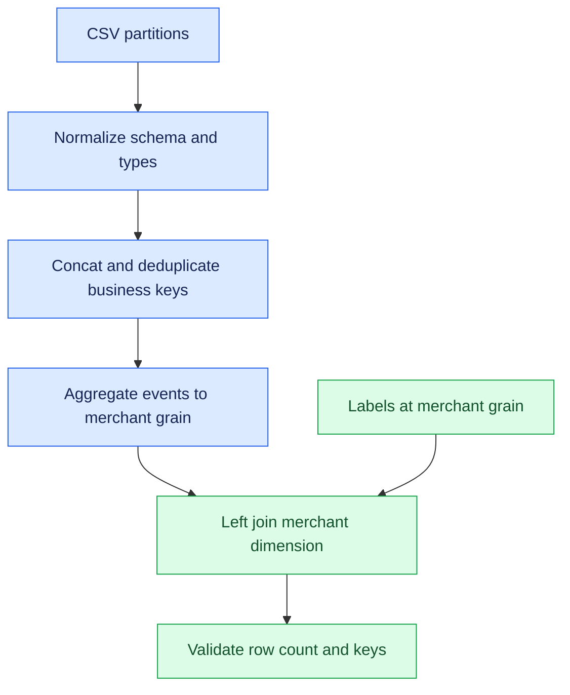

# 08 — NumPy & Multi-file Data Integration


[返回目錄](README.md)

## 1. NumPy essentials

| Operation | Syntax | Notes |
|---|---|---|
| Array | `np.array([1,2,3])` | homogeneous dtype |
| Shape | `a.shape`, `a.ndim` | inspect dimensions |
| Select column | `X[:, 1]` | all rows, second column |
| Boolean mask | `a[a>0]` | array selection |
| Conditional | `np.where(a>0,1,0)` | elementwise |
| Mean | `X.mean(axis=0)` | one mean per column |
| Reshape | `a.reshape(-1,1)` | column vector |
| Combine | `np.concatenate([a,b],axis=0)` | compatible other dimensions |
| Missing | `np.isnan(a)`, `np.nanmean(a)` | floating numeric arrays |
| Infinity | `np.isfinite(a)` | excludes NaN and ±inf |
| Sort index | `np.argsort(a)` | positions, not values |

```python
import numpy as np
X=np.array([[1.,10.],[3.,20.],[5.,30.]])
print(X.mean(axis=0))  # [3.,20.]
print(X.mean(axis=1))  # [5.5,11.5,17.5]
Z=(X-X.mean(axis=0))/X.std(axis=0)
print(Z.shape)  # (3,2)
```

Broadcasting aligns trailing dimensions. `(3,2)-(2,)` works, but `(3,2)-(3,)` fails. For row means use `keepdims=True` to preserve shape `(3,1)`. For ML, fit the scaler only on training data, preferably in a Pipeline. A constant column has zero standard deviation; manual division needs handling.

```python
num=np.array([100.,0.,50.]); den=np.array([0.,0.,10.])
ratio=np.divide(num,den,out=np.full(num.shape,np.nan),where=den!=0)
# [nan, nan, 5.]
```

`np.where(den!=0,num/den,np.nan)` can still evaluate the division and emit a warning; `np.divide(..., where=...)` avoids evaluating those divisions.

**Practice:** `P=np.array([[.8,.2],[.3,.7],[.4,.6]])`. Obtain class 1 probabilities and predicted labels at threshold .65.

<details><summary>Answer</summary>

`p=P[:,1]` gives `[.2,.7,.6]`; `(p>=.65).astype(int)` gives `[0,1,0]`. Assumes columns are ordered class 0 then class 1.

</details>

## 2. CSV ingestion & schema normalization

```python
import pandas as pd
from pathlib import Path
paths=sorted(Path('data').glob('orders_*.csv'))
frames=[]
for path in paths:
    df=pd.read_csv(path,dtype={'merchant_id':'string','order_id':'string','customer_id':'string'})
    df.columns=df.columns.str.strip().str.lower()
    frames.append(df)
orders=pd.concat(frames,ignore_index=True)
orders['order_date']=pd.to_datetime(orders['order_date'],errors='coerce')
orders['amount']=pd.to_numeric(orders['amount'],errors='coerce')
```

For inconsistent headers, normalize before specifying field-specific types, or read all columns as strings and explicitly convert numerics. `dtype` protects leading zero IDs; do not convert identifiers to numeric. `concat` stacks partitions by matching column names, while `merge` relates records by key. Missing columns after concat become NaN: inspect schema rather than silently accepting errors.

## 3. Deduplication and join grain

`drop_duplicates()` removes identical rows. `drop_duplicates(subset=['order_id'],keep='last')` removes repeated business IDs; when duplicates represent updates, sort by update timestamp first. Different line items of one order must not be collapsed just because order_id repeats.



| Relationship | Example | Check |
|---|---|---|
| one-to-one | merchant to label | `validate='one_to_one'` |
| many-to-one | orders to merchant | `validate='many_to_one'` |
| one-to-many | merchant to orders | `validate='one_to_many'` |
| many-to-many | orders to support events via merchant | aggregate separately first |

A merchant with 3 orders and 2 tickets creates 6 rows if raw event tables are joined on merchant_id. GMV and ticket counts inflate. Use `merge(...,indicator=True)` to audit unmatched keys; pandas may match null keys to null keys unlike SQL, so check them explicitly. For a left join, filtering right-side columns afterwards can eliminate unmatched merchants.

## 4. Seven-file practice

See [mock assessment Q9–Q11](09-mock.md) for a runnable dataset with seven CSV files, four logical tables, inconsistent headers, repeated business IDs, bad amounts, multiple event grains, missing values and unseen categories. All data is synthetic. Complete data preparation before running the classifier.

## 5. Python / NumPy 核心複習（P0）

| Concept | 常用語法 | 重點 |
|---|---|---|
| List / tuple | [1,2], (1,2) | tuple 不可變；list 可變 |
| Dict / set | {k:v for k,v in pairs}, set(values) | mapping、去重、membership |
| Sorting | sorted(rows,key=lambda r:r[1],reverse=True) | key 是排序依據 |
| Iteration | zip(ids,values), enumerate(values) | zip 預設截到最短 |
| Function | def f(x,threshold=0): return x>threshold | 避免可變 default arguments |
| Array creation | np.arange(6).reshape(3,2) | reshape 元素總數不變 |
| Indexing | a[:,0], a[[0,2]], a[a>0] | slice 通常 view；advanced indexing 是 copy |
| Aggregation | a.sum(axis=0), a.mean(axis=1) | axis=0 沿列消去；axis=1 沿欄消去 |
| Ranking | np.argsort(a), np.argmax(a) | index 而非 value |
| Matrix | X @ w, X * w | matrix product vs elementwise |
| Random | np.random.default_rng(42) | 可重現的 generator |

```python
import numpy as np
a=np.arange(6).reshape(3,2)
# [[0,1],[2,3],[4,5]]
a.sum(axis=0)  # [6,9]
a.sum(axis=1)  # [1,5,9]
a - a.mean(axis=0)  # column centering
a - a.mean(axis=1,keepdims=True)  # row centering
a @ np.array([2,3])  # [3,13,23]
np.unique(a,return_counts=True)
np.quantile(a,[.25,.5,.75])
```

### 多檔案整合：可重用的 ingestion pattern

```python
from pathlib import Path
import pandas as pd

def load_partitions(paths, required, aliases=None):
    frames=[]
    for path in sorted(paths):
        df=pd.read_csv(path,dtype='string')
        df.columns=df.columns.str.strip().str.lower()
        df=df.rename(columns=aliases or {})
        if not df.columns.is_unique:
            raise ValueError(f'Duplicate columns: {path}')
        missing=set(required)-set(df.columns)
        if missing:
            raise ValueError(f'{path}: missing {missing}')
        frames.append(df.assign(source_file=Path(path).name))
    if not frames:
        raise ValueError('No input files')
    return pd.concat(frames,ignore_index=True)

# Example: paths = Path('data').glob('orders_*.csv')
# orders = load_partitions(paths,['order_id','merchant_id','amount','order_date'])
# orders['amount'] = pd.to_numeric(orders.amount,errors='coerce')
# orders['order_date'] = pd.to_datetime(orders.order_date,errors='coerce')
```

不同邏輯表不要 concat；先各自整理後按 key merge。資料檢核至少包括 schema、ID 唯一性、null key、unmatched keys、row count、金額對帳、時間邊界。若 labels 為未來期間結果，features 必須只使用 cutoff 前的 events。資料量很大才考慮 chunksize；跨 chunk 的 distinct count 不能直接相加（P1）。

<details><summary>Concept check：為何同一商家的 orders 與 support tickets 不宜直接 merge？</summary>

兩者都是一對多事件表，直接按 merchant_id merge 會產生 many-to-many fanout。各自先 groupby 到商家粒度，再 left join 商家主表，才能保留沒有事件的商家且避免重複計算。

</details>

## English assessment language

| English wording | 中文解讀 |
|---|---|
| Concatenate the files row-wise. | 將相同邏輯表的分區縱向合併 |
| Preserve leading zeros in identifiers. | ID 讀為字串 |
| Normalize inconsistent column names. | 統一欄名與 alias |
| Remove duplicate records, keeping the most recent update. | 按時間排序後依 business key 去重 |
| Ensure a one-to-one correspondence between IDs and predictions. | 確認輸出 ID 對應且沒有重複或遺漏 |
| Compute the column-wise mean. | axis=0，對每欄聚合 |
| Apply an element-wise transformation. | 逐元素轉換，不是矩陣乘法 |

```python
import numpy as np
a=np.array([[1,2],[3,4],[5,6]])
a.mean(axis=0) # [3.,4.]
a.mean(axis=1) # [1.5,3.5,5.5]
a-a.mean(axis=0) # [[-2,-2],[0,0],[2,2]]
```

Broadcasting compares trailing dimensions; (3,2) minus (2,) works. For row-wise centering use a.mean(axis=1,keepdims=True) so shape is (3,1). 不需深入 stride、底層記憶體配置。
