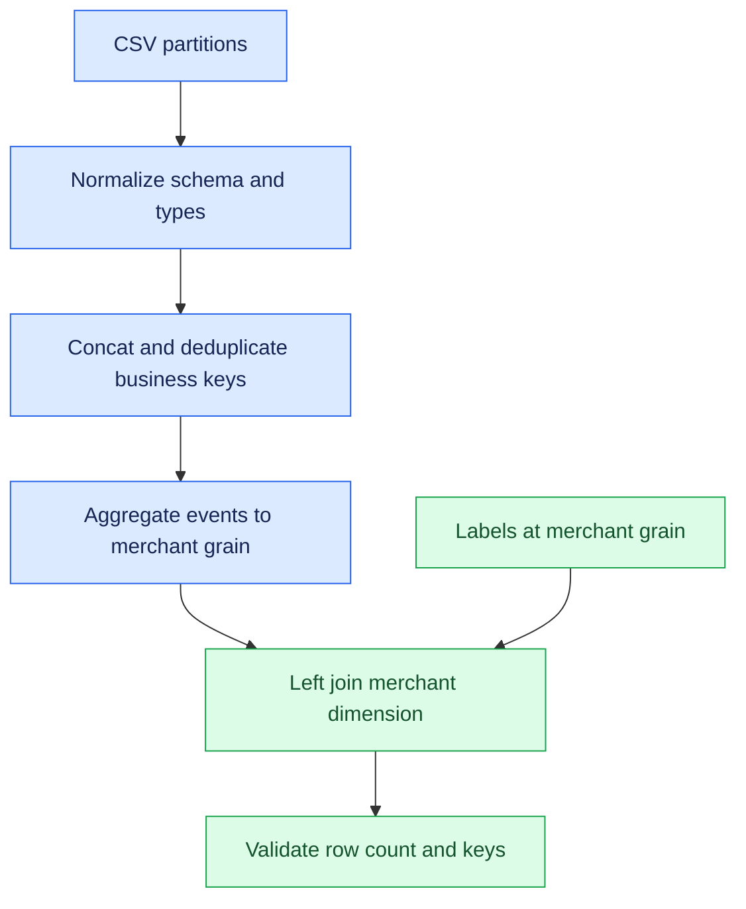

# 08 — NumPy & Multi-file Data Integration


[返回目錄](README.md)

## 1. NumPy essentials

| Operation | Syntax | Notes |
|---|---|---|
| Array | `np.array([1,2,3])` | homogeneous dtype |
| Shape | `a.shape`, `a.ndim` | inspect dimensions |
| Select column | `X[:, 1]` | all rows, second column |
| Boolean mask | `a[a>0]` | array selection |
| Conditional | `np.where(a>0,1,0)` | elementwise |
| Mean | `X.mean(axis=0)` | one mean per column |
| Reshape | `a.reshape(-1,1)` | column vector |
| Combine | `np.concatenate([a,b],axis=0)` | compatible other dimensions |
| Missing | `np.isnan(a)`, `np.nanmean(a)` | floating numeric arrays |
| Infinity | `np.isfinite(a)` | excludes NaN and ±inf |
| Sort index | `np.argsort(a)` | positions, not values |

```python
import numpy as np
X=np.array([[1.,10.],[3.,20.],[5.,30.]])
print(X.mean(axis=0))  # [3.,20.]
print(X.mean(axis=1))  # [5.5,11.5,17.5]
Z=(X-X.mean(axis=0))/X.std(axis=0)
print(Z.shape)  # (3,2)
```

Broadcasting aligns trailing dimensions. `(3,2)-(2,)` works, but `(3,2)-(3,)` fails. For row means use `keepdims=True` to preserve shape `(3,1)`. For ML, fit the scaler only on training data, preferably in a Pipeline. A constant column has zero standard deviation; manual division needs handling.

```python
num=np.array([100.,0.,50.]); den=np.array([0.,0.,10.])
ratio=np.divide(num,den,out=np.full(num.shape,np.nan),where=den!=0)
# [nan, nan, 5.]
```

`np.where(den!=0,num/den,np.nan)` can still evaluate the division and emit a warning; `np.divide(..., where=...)` avoids evaluating those divisions.

**Practice:** `P=np.array([[.8,.2],[.3,.7],[.4,.6]])`. Obtain class 1 probabilities and predicted labels at threshold .65.

<details><summary>Answer</summary>

`p=P[:,1]` gives `[.2,.7,.6]`; `(p>=.65).astype(int)` gives `[0,1,0]`. Assumes columns are ordered class 0 then class 1.

</details>

## 2. CSV ingestion & schema normalization

```python
import pandas as pd
from pathlib import Path
paths=sorted(Path('data').glob('orders_*.csv'))
frames=[]
for path in paths:
    df=pd.read_csv(path,dtype={'merchant_id':'string','order_id':'string','customer_id':'string'})
    df.columns=df.columns.str.strip().str.lower()
    frames.append(df)
orders=pd.concat(frames,ignore_index=True)
orders['order_date']=pd.to_datetime(orders['order_date'],errors='coerce')
orders['amount']=pd.to_numeric(orders['amount'],errors='coerce')
```

For inconsistent headers, normalize before specifying field-specific types, or read all columns as strings and explicitly convert numerics. `dtype` protects leading zero IDs; do not convert identifiers to numeric. `concat` stacks partitions by matching column names, while `merge` relates records by key. Missing columns after concat become NaN: inspect schema rather than silently accepting errors.

## 3. Deduplication and join grain

`drop_duplicates()` removes identical rows. `drop_duplicates(subset=['order_id'],keep='last')` removes repeated business IDs; when duplicates represent updates, sort by update timestamp first. Different line items of one order must not be collapsed just because order_id repeats.



| Relationship | Example | Check |
|---|---|---|
| one-to-one | merchant to label | `validate='one_to_one'` |
| many-to-one | orders to merchant | `validate='many_to_one'` |
| one-to-many | merchant to orders | `validate='one_to_many'` |
| many-to-many | orders to support events via merchant | aggregate separately first |

A merchant with 3 orders and 2 tickets creates 6 rows if raw event tables are joined on merchant_id. GMV and ticket counts inflate. Use `merge(...,indicator=True)` to audit unmatched keys; pandas may match null keys to null keys unlike SQL, so check them explicitly. For a left join, filtering right-side columns afterwards can eliminate unmatched merchants.

## 4. Seven-file practice

See [mock assessment Q9–Q11](09-mock.md) for a runnable dataset with seven CSV files, four logical tables, inconsistent headers, repeated business IDs, bad amounts, multiple event grains, missing values and unseen categories. All data is synthetic. Complete data preparation before running the classifier.
