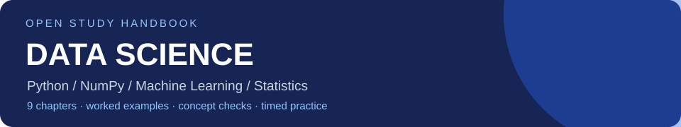

# Data Science Comprehensive Review Handbook

繁體中文技術教材 · Python / pandas / NumPy / scikit-learn / ML / Statistics

| 章節 | 內容 |
|---|---|
| 🔵 [01 pandas](01-pandas.md) | 資料擷取、彙總、合併、日期及視窗 |
| 🟢 [02 Preprocessing](02-preprocessing.md) | 缺失值、編碼、特徵工程、Pipeline |
| 🟣 [03 Model Development & Evaluation](03-models.md) | 模型訓練、評估、調參、Log Loss |
| 🟠 [04 ML Fundamentals](04-ml.md) | 演算法、Ensemble、驗證及泛化 |
| 🔴 [05 Probability & Statistics](05-statistics.md) | 機率、期望值、推論與實驗 |
| 🔵 [06 Integrated Cases](06-cases.md) | pandas 商業分析、Churn Classification、House Price Regression 完整解法 |
| ⚪ [07 Cheat Sheet & Common Pitfalls](07-review.md) | 速查、錯誤觀念修正 |
| 🟢 [08 Python / NumPy & Multi-file Data Integration](08-numpy-data.md) | Python、NumPy、七份 CSV、四張邏輯表、schema validation |
| 🟣 [09 Timed Mock Assessment（選用）](09-mock.md) | 90 分鐘、11 題原創模擬考 |

## 如何使用

以閱讀複習為主：01–05、08 是核心教材；06 是完整案例與參考解法；07 是速查；09 是選用的獨立模擬考，不是閱讀進度的必要條件。各章的 Concept Check 用於觀念釐清與自我審視，可直接展開答案。09 的 CSV 位於 `data/`，完整程式位於 `solutions/`。

### 教材優先級

- **P0 核心**：原理、公式、常用語法、重要參數、範例、方法選擇與陷阱。
- **P1 延伸**：重要變體、特殊情境與實務限制。
- **P2 認識即可**：冷門 API、底層細節、非必要證明。

Probability & Statistics 從基本定義逐步建立；其餘章節採全面複習深度。不以大量獨立練習為主，優先提供可直接閱讀的 worked examples 和少量有鑑別度的 concept checks。

> [!NOTE]
> 所有資料與題目均為合成或原創教材，不代表任何正式測驗題庫、官方規格或錄取標準。90 分鐘是練習設定。程式以常用 pandas / NumPy / scikit-learn API 為主；獨立片段未全部執行驗證。

## 核心知識索引

| Knowledge area | 建議閱讀 |
|---|---|
| Python、NumPy、資料讀取與多檔案整合 | [08](08-numpy-data.md)、[01](01-pandas.md) |
| Filtering、groupby、join、reshape、strings、datetime、windows | [01](01-pandas.md) |
| Missing values、outliers、scaling、encoding、feature engineering、selection、imbalance | [02](02-preprocessing.md) |
| Regression、classification、clustering、metrics、CV、tuning、calibration、submission | [03](03-models.md) |
| Algorithm mechanisms、loss、regularization、ensembles、optimization、PCA、generalization、drift | [04](04-ml.md) |
| Probability、Bayes、counting、distributions、expectation、sampling、CI、statistical tests、A/B testing | [05](05-statistics.md) |
| End-to-end worked examples | [06](06-cases.md) |
| Quick reference | [07](07-review.md) |

建議先讀 08 的 Python/NumPy 基礎，再讀 01–05；已熟悉基礎者可直接按主題跳讀。06 提供完整案例供閱讀，不必先作答。09 保留作選用模擬考。此索引是通用資料科學複習範圍，不是正式考試規格。
