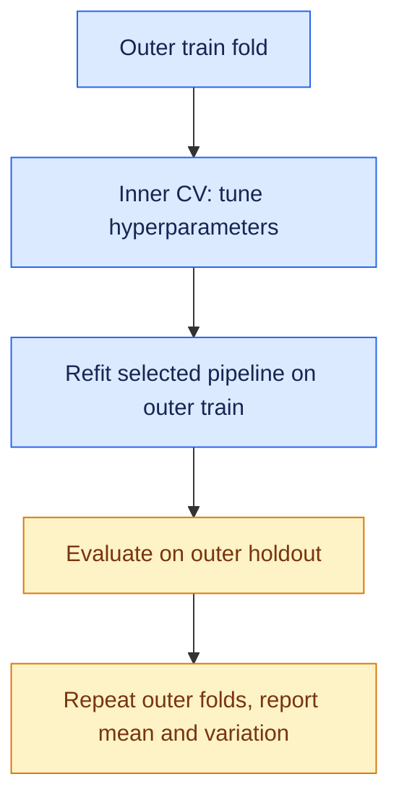

# 04.5 — Bias-Variance, Validation & Data Leakage

[← Chapter index](../04-ml.md) · [Previous](04-unsupervised.md) · [Next →](06-drift-interpretation.md)

> Core review · 中文觀念解釋、English terminology、worked examples、variation questions。先理解，再展開答案。

## Bias–variance & regularization 

Squared loss 的期望預測誤差可分解為 bias² + variance + irreducible noise（固定 x、對訓練集與噪音取期望）。

| Pattern | Interpretation | Action |
|---|---|---|
| Train poor, validation poor | 可能 underfit/high bias | 更合適特徵、提高容量、減少正則化 |
| Train strong, validation poor | 可能 overfit/high variance | 更多資料、正則化、簡化模型 |
| Both strong | 泛化可能良好 | 仍需獨立 test 與 drift 檢查 |

資料分布改變也會造成 train/valid gap，不應直接斷定 overfitting。Learning curve 比較不同 training size 的 train/valid performance。

## Validation, leakage & nested CV 

| Risk | Example | Remedy |
|---|---|---|
| Temporal leakage | 用下月 GMV 預測本月 churn | as-of feature snapshot / time split |
| Group leakage | 同商家同時出現在 train/test | group-based split |
| Preprocessing leakage | split 前以全部資料 fit scaler | fit only train, Pipeline |
| Target leakage | churn 後客服結案狀態 | 移除預測時不可取得欄位 |
| Feature selection leakage | 全部 labels 選特徵再 CV | selector 放 Pipeline |
| Test selection bias | 12 個模型在同一 test 選最高 AUC | validation 選，獨立 test 報告 |



Nested CV 外層估計完整模型選擇流程的泛化；內層調參。最終可在所有 development data 再調參並 fit 部署模型，另有 untouched test 時只評估一次。不是把 outer scores 最大的 fold 模型當作最終模型。

```python
from sklearn.model_selection import cross_val_score, GridSearchCV, StratifiedKFold
inner = StratifiedKFold(3,shuffle=True,random_state=42)
outer = StratifiedKFold(5,shuffle=True,random_state=43)
search = GridSearchCV(pipeline,{'model__C':[.1,1,10]},cv=inner,scoring='roc_auc')
scores = cross_val_score(search,X,y,cv=outer,scoring='roc_auc')
```

## Generalization: how to diagnose and act

Learning curve varies sample size; validation curve varies hyperparameter. High bias may show both train and validation poor; high variance may show large gap. Additional representative data often helps high variance. Irreducible noise cannot be removed by model complexity.

| Leakage type | Scenario |
|---|---|
| Target leakage | post-churn status predicts churn |
| Temporal | future events used to predict past |
| Group | same subject in train/test when target is unseen subjects |
| Preprocessing | supervised selector fit before CV |
| Test selection | selecting best of 12 models using same test |

<details><summary>Variation: A merchant appears in training history and in future test months. Is that necessarily leakage?</summary>

No. 若部署目標是既有商家未來表現，按時間切分與 as-of features 可能合理；若目標是全新商家，應 group isolate。Split matches deployment.

</details>

<details><summary>Variation: All feature labels were used for selection, then 5-fold CV was applied. Is CV unbiased?</summary>

No. Validation labels influence feature subset. Put selector in Pipeline and fit independently inside folds.

</details>

[← Chapter index](../04-ml.md) · [Next →](06-drift-interpretation.md)
