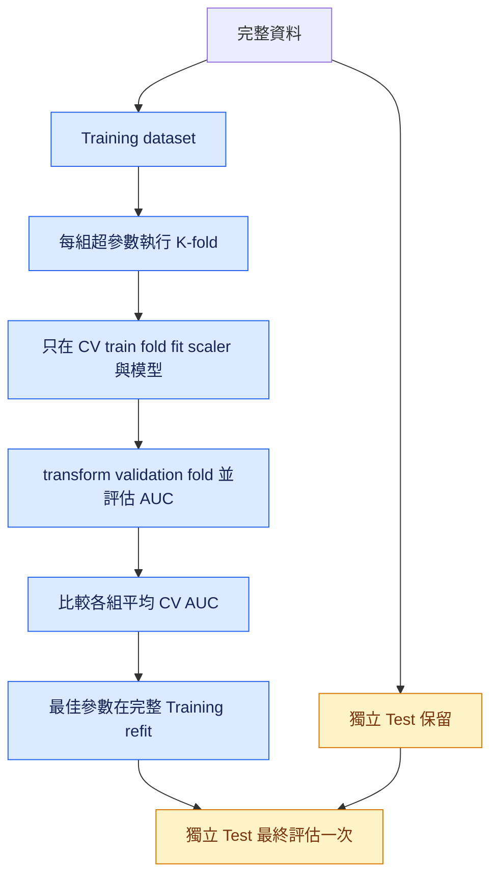

# 03.1 — Model Workflow & Validation

[← Chapter index](../03-models.md) · [Next →](02-classification-metrics.md)

> Core review · 中文觀念解釋、English terminology、worked examples、variation questions。先理解，再展開答案。

## Dataset splitting 

| Dataset | 用途 | 是否 fit |
|---|---|---|
| Training | 學習模型與 preprocessing 參數 | 是 |
| Validation | 模型、超參數、threshold 選擇 | 否（評估當下） |
| Test | 最終泛化評估 | 否 |

```python
from sklearn.model_selection import train_test_split
X_dev, X_test, y_dev, y_test = train_test_split(
    X, y, test_size=.2, stratify=y, random_state=42)
X_train, X_valid, y_train, y_valid = train_test_split(
    X_dev, y_dev, test_size=.25, stratify=y_dev, random_state=42)
```

比例為 60/20/20。`stratify` 保留近似 class ratio；不能保證 merchant ID 隔離。若同一商家多筆資料，使用 GroupKFold/GroupShuffleSplit（或視需求 StratifiedGroupKFold）；若預測未來，按時間切分，必要時加 gap。切分方法取決於部署目標：預測既有商家未來訂單與預測新商家是不同任務。

## Model development 

```python
from sklearn.linear_model import LogisticRegression
from sklearn.ensemble import RandomForestClassifier
from sklearn.metrics import roc_auc_score
models = {
    'logistic': LogisticRegression(C=1, max_iter=1000, random_state=42),
    'random_forest': RandomForestClassifier(n_estimators=100, max_depth=3, random_state=42)
}
scores = {}
for name, model in models.items():
    model.fit(X_train, y_train)
    scores[name] = roc_auc_score(y_valid, model.predict_proba(X_valid)[:, 1])
best_name = max(scores, key=scores.get)
best_model = models[best_name]
test_auc = roc_auc_score(y_test, best_model.predict_proba(X_test)[:, 1])
```

範例假設 features 已正確預處理、binary labels 為 0/1，且 `classes_[1]` 是正類。`predict()` 回傳預測類別；`predict_proba()` 回傳各類別機率（順序依 `classes_`）；`decision_function()` 可提供排序分數供 AUC 使用。`max(scores, key=scores.get)` 回傳 key；`max(scores.items(), key=lambda x:x[1])` 回傳 (key,value)。若同分，Python max 取第一個遇到的項目。

> 完成選模後，可以依事先決定的流程用 train+val 重訓；但不可用 test 選模型、調參或 threshold。下方兩個程式示例是替代流程，不是依序在同一個 test 上選模。

## K-Fold + StandardScaler + GridSearchCV（重要筆記） 



```python
from sklearn.pipeline import Pipeline
from sklearn.preprocessing import StandardScaler
from sklearn.model_selection import GridSearchCV, StratifiedKFold
from sklearn.linear_model import LogisticRegression
from sklearn.metrics import roc_auc_score
pipeline = Pipeline([
    ('scaler', StandardScaler()),
    ('model', LogisticRegression(max_iter=1000, random_state=42))
])
cv = StratifiedKFold(n_splits=5, shuffle=True, random_state=42)
grid = GridSearchCV(pipeline, {'model__C':[.01,.1,1,10]},
                    scoring='roc_auc', cv=cv, refit=True)
grid.fit(X_train, y_train)
best_model = grid.best_estimator_
best_params = grid.best_params_
best_cv_auc = grid.best_score_
test_auc = roc_auc_score(y_test, best_model.predict_proba(X_test)[:,1])
```

若混合數值與類別特徵，將 StandardScaler 步驟換成 [ColumnTransformer](../preprocessing/04-pipeline.md)。`model__C` 中 `model` 必須等於 Pipeline step 名稱。`refit=True` 會以最佳參數重新 fit 全部傳入 grid.fit 的資料；`grid.predict_proba()` 此時等同最佳 pipeline 的 predict_proba。5-fold × 4 組參數 = 20 次 CV fits，另有 1 次 refit。best_score_ 是最佳 CV 分數，不是無偏的 final test score。

## Worked variation — 70/15/15 versus ordinary split

若資料已提供 train.csv / val.csv / test.csv，直接讀取即可。若需自己切分 70/15/15，先留 30%，再將剩餘 30% 平分成 validation/test。Regression 不應直接 stratify continuous y；若有時間或群組依賴，改用相應 split。

```python
from sklearn.model_selection import train_test_split
Xtr,Xrest,ytr,yrest=train_test_split(X,y,test_size=.30,random_state=42)
Xv,Xt,yv,yt=train_test_split(Xrest,yrest,test_size=.50,random_state=42)
```

這是 IID regression 例子；分類可依各次 split 的 label stratify，少數類樣本必須足夠。CodeSignal-style free-form regression 案例請見 [06.3](../cases/03-house-price.md)。

## Choosing a split — variation scenarios

| Scenario | Appropriate strategy |
|---|---|
| IID binary data, rare positives | Stratified split |
| Multiple rows for same person, new-person prediction | Group split |
| Forecast next month | Chronological split |
| Model tuning + unbiased performance estimate without external holdout | Nested CV |

**English:** Select the model with the highest mean validation score; reserve the test set for final evaluation.

GridSearchCV.best_score_ 是 tuning folds 的最佳平均分數，因選擇最大值而可能 optimistic。best_estimator_ 是 refit 後的模型（refit=True）；best_params_ 為最佳設定。Nested CV 的 outer folds 評估整個選模程序，inner folds 做 tuning。

<details><summary>Variation: Training accuracy is 98% and validation is 66%. Does this prove overfitting?</summary>

No. 可能是 high variance，亦可能是 distribution shift、group leakage 或資料品質差異。檢查 split、train/val distributions，再用 learning curve 與 regularization 診斷。

</details>

<details><summary>Variation: A dataset has train.csv, val.csv and an unlabeled test.csv. Must you create a new holdout from train.csv?</summary>

No. Existing validation already supports model selection. CV within train is optional; avoid unnecessarily reducing training data. Test remains for predictions only.

</details>

[← Chapter index](../03-models.md) · [Next →](02-classification-metrics.md)
