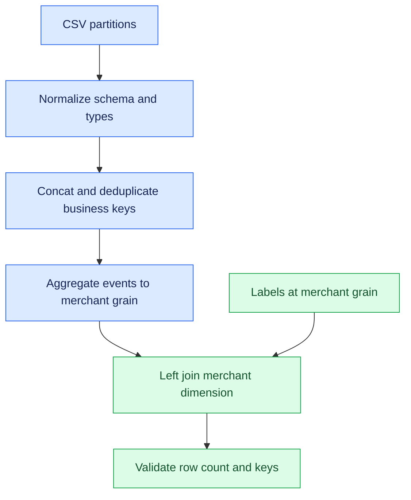

# 08.2 — Multi-file Data Integration

[← Chapter index](../08-numpy-data.md) · [Previous](01-python-numpy.md)

## Schema normalization and reading CSV files

**English:** Normalize inconsistent column names, preserve identifier strings and concatenate partitions of the same logical table.

Read as strings before header normalization to avoid losing leading zero IDs when column names differ. Validate required columns before concat.


```python
from pathlib import Path
import pandas as pd

def load_partitions(paths, required, aliases=None):
    frames=[]
    for path in sorted(paths):
        df=pd.read_csv(path,dtype='string')
        df.columns=df.columns.str.strip().str.lower()
        df=df.rename(columns=aliases or {})
        if not df.columns.is_unique:
            raise ValueError(f'Duplicate columns: {path}')
        missing=set(required)-set(df.columns)
        if missing:
            raise ValueError(f'{path}: missing {missing}')
        frames.append(df.assign(source_file=Path(path).name))
    if not frames:
        raise ValueError('No input files')
    return pd.concat(frames,ignore_index=True)

# Example: paths = Path('data').glob('orders_*.csv')
# orders = load_partitions(paths,['order_id','merchant_id','amount','order_date'])
# orders['amount'] = pd.to_numeric(orders.amount,errors='coerce')
# orders['order_date'] = pd.to_datetime(orders.order_date,errors='coerce')
```

不同邏輯表不要 concat；先各自整理後按 key merge。資料檢核至少包括 schema、ID 唯一性、null key、unmatched keys、row count、金額對帳、時間邊界。若 labels 為未來期間結果，features 必須只使用 cutoff 前的 events。資料量很大才考慮 chunksize；跨 chunk 的 distinct count 不能直接相加（P1）。

<details><summary>Concept check：為何同一商家的 orders 與 support tickets 不宜直接 merge？</summary>

兩者都是一對多事件表，直接按 merchant_id merge 會產生 many-to-many fanout。各自先 groupby 到商家粒度，再 left join 商家主表，才能保留沒有事件的商家且避免重複計算。

</details>

## Deduplication and join grain

`drop_duplicates()` removes identical rows. `drop_duplicates(subset=['order_id'],keep='last')` removes repeated business IDs; when duplicates represent updates, sort by update timestamp first. Different line items of one order must not be collapsed just because order_id repeats.



| Relationship | Example | Check |
|---|---|---|
| one-to-one | merchant to label | `validate='one_to_one'` |
| many-to-one | orders to merchant | `validate='many_to_one'` |
| one-to-many | merchant to orders | `validate='one_to_many'` |
| many-to-many | orders to support events via merchant | aggregate separately first |

A merchant with 3 orders and 2 tickets creates 6 rows if raw event tables are joined on merchant_id. GMV and ticket counts inflate. Use `merge(...,indicator=True)` to audit unmatched keys; pandas may match null keys to null keys unlike SQL, so check them explicitly. For a left join, filtering right-side columns afterwards can eliminate unmatched merchants.

## Worked variation — partition versus entity

Suppose there are three order partitions, two support partitions, a merchant dimension and a label file. That is seven CSV files but four logical tables (illustrative synthetic setup, not verified official exam structure). Concatenate order partitions, concatenate support partitions, then independently aggregate both to merchant level. Left join aggregates to merchant universe, then join labels with validated cardinality. Do not concatenate all seven files or join raw events on merchant_id.

<details><summary>Variation: One CSV contains Order_ID while others use order_id. Why might dtype={'order_id':'string'} be insufficient?</summary>

It applies by exact original header. Read all columns as strings, normalize headers and aliases, then convert numeric/date fields explicitly. Detect duplicate headers after normalization.

</details>

<details><summary>Variation: Two partitions contain the same order_id with different amounts. Which amount should be kept?</summary>

Depends on data semantics. If updates, choose latest valid updated_at plus deterministic tie-break. If order line items, use composite order_id/line_id key. Do not blindly remove duplicates.

</details>

See [optional mock assessment](../09-mock.md) for the existing synthetic multi-file exercise.
